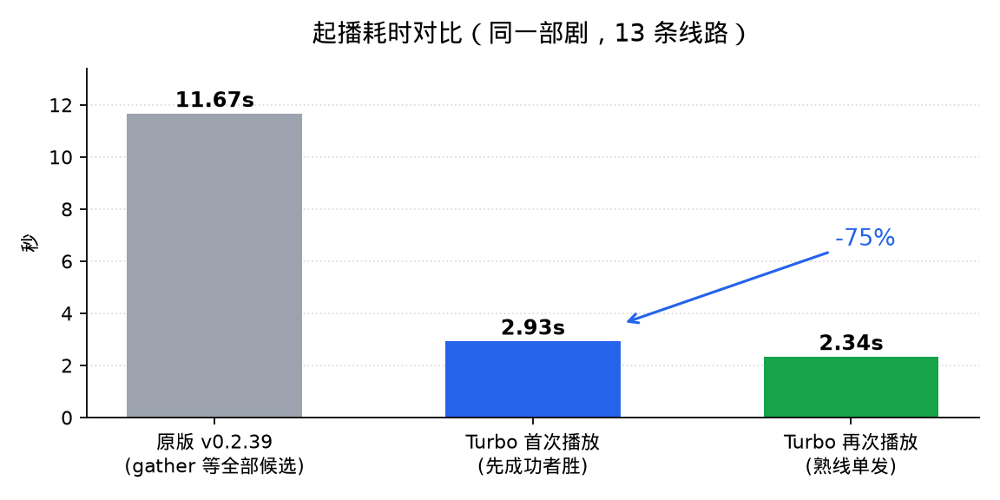
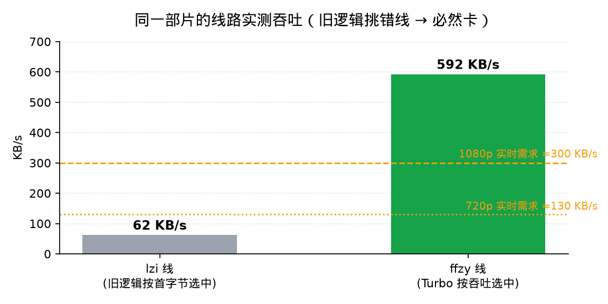

# fnmedia-ext Turbo

> **Optimized build of the fnOS Video online extension** (飞牛影视在线扩展).
> Based on upstream [**yujian0815/fnmedia-ext**](https://github.com/yujian0815/fnmedia-ext) **v0.2.39** (full build).
> All upstream features are kept — only the playback path is optimized.

[](#-which-upstream-version-is-this-based-on)
[](LICENSE)
[](#-install)

**中文文档: [README.md](README.md)**

---

## 🙏 Credits first

99% of this project belongs to the original author **[yujian0815](https://github.com/yujian0815)** and the
[**fnmedia-ext**](https://github.com/yujian0815/fnmedia-ext) project.

The original work solves the hard part: it takes over the official fnOS Video entry point via an atomic
Unix-socket rename — **fully reversible, without patching official binaries, nginx or the database** — and adds
native search aggregation, four Douban chart libraries, four huge category libraries, m3u8/mp4 proxy playback,
multi-line switching, playback history and in-app admin page.

This repository only fixes a few spots on the playback path that make start-up slow, and quantifies the
difference. **Please star the original repository first** — it deserves it.

- Upstream: <https://github.com/yujian0815/fnmedia-ext>
- License: MIT © 2026 yujian0815 (this repo is also MIT, original notice retained — see [LICENSE](LICENSE))

## 📌 Which upstream version is this based on

| Item | Value |
|---|---|
| **Upstream base** | **v0.2.39** (full build) |
| This release | **v1.0.0** |
| fnOS Video (trim.media) | 0.9.8-1 (tested) |
| fnOS | ≥ 1.2.0 (tested on 1.2.0800) |
| Arch | all (pure Python, venv created on install) |

### 🔍 Verifiable

| Check | Result |
|---|---|
| Upstream tag | v0.2.39 (commit d782c58), released 2026-10-31T07:34:43Z |
| Local repo/VERSION | 0.2.39 |
| File-by-file diff vs upstream v0.2.39 source | **46 / 56 files byte-identical** |
| The 10 differing files | this repo's patches (proxy/app.py, proxy/supervise.py), the earlier fix patch (proxy/store.py, proxy/providers.py), and full-build vs public-source differences (features.py, admin_ui.py, tvbox.py, config.py, requirements.txt, CHANGELOG.md) |

> If the App Center shows 0.2.33, that is the version of the **originally installed FPK**. The app ships a
> built-in updater that replaces the code under repo/ but does not rewrite the App Center manifest, so the
> number stays behind. Always check repo/VERSION for the real version.

> Upstream also publishes full (116.9 MB, with non-public modules) and standard (0.8 MB) packages; the test
> machine runs the full one, hence wasmtime in requirements.txt and DDUO/CATVOD = True in features.py —
> which is exactly why this Release only ships the **public build** (stripped).

> Note: upstream is now at v0.2.67. We checked it — **supervise.py still hard-codes the 16 s wait window and
> hls_seg still buffers the whole segment** before responding, so the problems this repo fixes still exist
> in the latest version; the optimizations here were developed and validated on v0.2.39.

## 📊 Results

Same NAS, same title, same source host, before vs after:

| Metric | Upstream v0.2.39 | Turbo v1.0.0 | Change |
|---|---|---|---|
| Time to start playback (13-line title) | **11.67 s** | **2.93 s** (first) / **2.34 s** (replay) | **-75%** |
| Segment time-to-first-byte | 1.5 ~ 55 s (= full segment download) | **0.09 ~ 0.70 s** | 10–50× faster |
| Line selection basis | first-byte latency only | latency + **measured throughput** | avoids 60 KB/s lines |
| Throughput of the chosen line | 55 ~ 70 KB/s (old logic picked it) | **592 KB/s** (new logic picks it) | 8–10× |
| DNS for source domains | cold lookup 5.0 ~ 5.2 s | cache hit **0.04 ~ 0.12 s** | 50× faster |
| Watchdog staging-socket wait | hard-coded 16 s | configurable **180 s** | fixes "starts then stops" |






> Method, environment and raw samples: [docs/BENCHMARK.md](docs/BENCHMARK.md). All numbers are measured on
> real hardware, not estimates. Absolute values vary with network and source-site conditions; the relative
> improvement is stable.

## 🔧 What changed (6 items)

### 1. Streaming segment relay (biggest win)
Upstream `hls_seg` does `body = r.content` — it downloads the **whole segment** before replying, so the
player's time-to-first-byte equals the full download time. Now bytes are relayed as they arrive; it falls
back to full buffering in three cases (upstream 4xx/5xx, PNG-wrapped segments, content-encoding), i.e. the
old behaviour is preserved for those.

### 2. "First success wins" line race
Upstream uses `asyncio.gather` and therefore waits for **every** candidate (or all timeouts). For a 13-line
title that meant 11.67 s to start, of which only 0.8 s was the actual winner — the rest was waiting for
candidates that were never going to win. Now: `FIRST_COMPLETED` + cancel the rest.

### 3. Single-probe fast path for known-good lines
Lines whose measured throughput is already known (≥ 200 KB/s) skip the parallel race entirely (racing six
lines on a slow link just makes them fight for bandwidth).

### 4. Throughput-aware line selection
The old race compared first-byte latency only, so it kept picking lines that answer fast but **transfer
slowly** (measured: 55~70 KB/s vs 592 KB/s on the same title, indistinguishable by latency). The proxy now
records each line's real download speed while playing (EMA, **zero extra traffic**) and ranks candidates by
it; unknown lines get a 150 KB/s prior so one bad measurement does not blacklist a line forever.

### 5. In-process DNS cache
Source domains use multi-level CNAMEs and glibc does not cache; 3 of 18 domains took 5.0~5.2 s on a cold
lookup. Added a 600 s / 2048-entry cache around `socket.getaddrinfo` — **process-local only**, system
`/etc/resolv.conf` untouched.

### 6. Watchdog wait window + boot hardening
The staging-socket wait was hard-coded to 80×0.2 s = 16 s, while startup must load `state/titles.json`
(22.8 s for a 3000+ title library, 16 s of it building the episode index) — so it **always** timed out and
the App Center showed "starts then stops". Now configurable via `FNMEDIA_STAGE_WAIT` (default 180 s).
Also added `ExecStartPre` to the systemd unit to wait for the venv interpreter (203/EXEC at boot when the
data volume is not mounted yet).

## 🚀 Install

App Center → **Manual install** → pick `fnmedia-ext-turbo-1.0.0-public.fpk` → accept the disclaimer.

- Internet access is required during install (`pip install fastapi uvicorn httpx` to build the venv).
- The app id is the same as upstream (`fnmedia-ext`), so on a machine that already has it this is treated as
an **upgrade**; `state/` (title cache, playback history, source config) is backed up and restored.
- A full uninstall/reinstall recreates the directory — back up
  `/vol1/@appcenter/fnmedia-ext/repo/state/` before doing that.

## ⚠️ Notes & disclaimer

- Like upstream, this repository **does not provide, bundle or distribute any media, source-site addresses or
  playback links**. All online content comes from third-party endpoints the user configures, and users are
  responsible for verifying legality.
- This is a **community modification, not an official release by the original author**. Report upstream bugs to
  the [original repo](https://github.com/yujian0815/fnmedia-ext); only the six optimizations above are in scope here.
- Upstream ships a public build and a full build; this repo's release is the **public build** (non-public
  modules stripped by upstream's own `public_strip.py`).
- MIT License, original copyright notice retained.

## 📁 Layout

```
assets/                   benchmark charts
docs/BENCHMARK.md         method, environment, raw data
RELEASE_NOTES_v1.0.0.md   release notes (incl. upstream base version)
```

---

**Thanks again to [yujian0815](https://github.com/yujian0815) and the fnmedia-ext project.**
