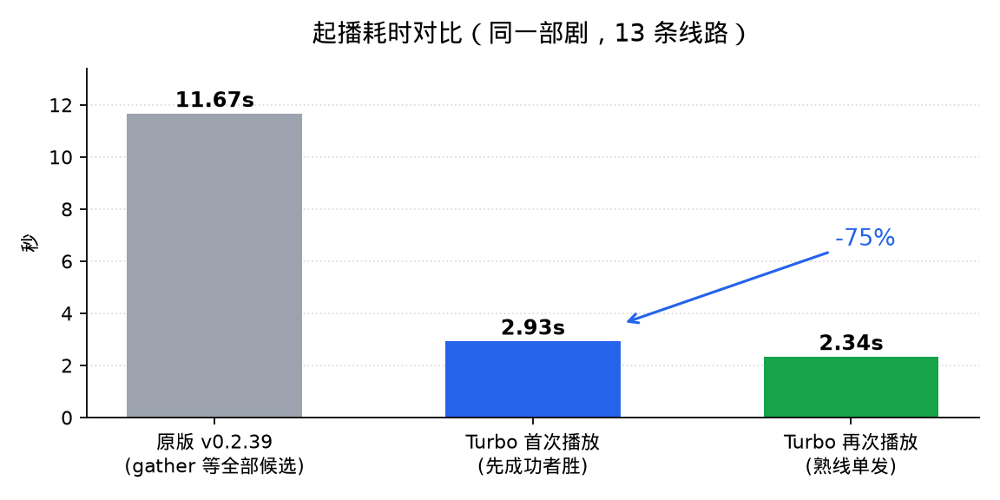
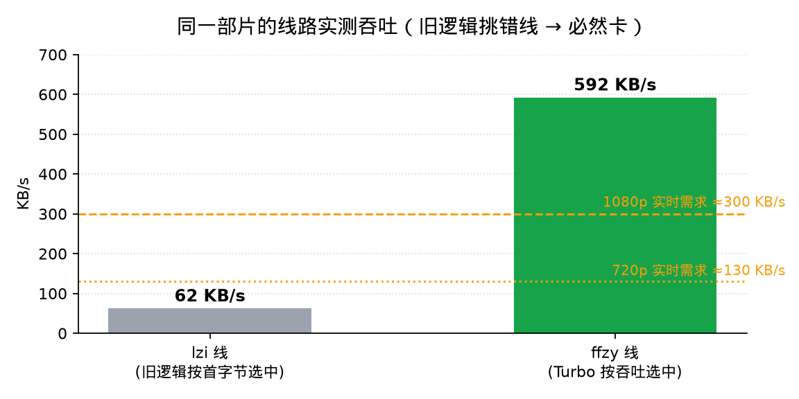

# fnmedia-ext Turbo

> **飞牛影视在线扩展 · 优化版**（FNmedia-ext **Turbo**）
> 基于原版 [**yujian0815/fnmedia-ext**](https://github.com/yujian0815/fnmedia-ext) **v0.2.39**（完整构建）修改，保留原版全部功能，只优化播放链路。

[](#-基于哪个版本)
[](LICENSE)
[](#-安装)

---

## 🙏 首先，感谢原版

这个项目 99% 的工作量属于原作者 **[yujian0815](https://github.com/yujian0815)** 的
[**fnmedia-ext**](https://github.com/yujian0815/fnmedia-ext)。

原版做的是最难的事：在不改官方二进制、不改 nginx、不改数据库的前提下，用 Unix Socket
原子换名**可逆接管**飞牛影视的入口，实现原生搜索聚合、豆瓣榜单四库、资源站海量分类四库、
m3u8/mp4 代理解析、多线路切换、播放记录与续播、应用内管理页……本仓库只是站在它的基础上，
把**播放链路上几处会拖慢起播的地方**改掉，并做了量化对比。

- 原版仓库：<https://github.com/yujian0815/fnmedia-ext>
- 原版 License：MIT © 2026 yujian0815（本仓库同样以 MIT 发布，见 [LICENSE](LICENSE)）
- 如果本项目对你有帮助，**请先去给原版点个 Star**。

## 📌 基于哪个版本

| 项目 | 值 |
|---|---|
| **基座版本** | 原版 **v0.2.39**（完整构建，含全部上游能力） |
| 本仓库版本 | **v1.0.0** |
| 适配飞牛影视 | trim.media 0.9.8-1（实测） |
| 适配 fnOS | ≥ 1.2.0（实测 1.2.0800） |
| 架构 | all（纯 Python，安装时建 venv） |


### 🔍 基座版本可复核

| 核对项 | 结果 |
|---|---|
| 上游 tag | `v0.2.39`（commit `d782c58`），Release 发布 2026-10-31T07:34:43Z |
| 本机代码 `repo/VERSION` | `0.2.39` |
| 与上游 v0.2.39 源码逐文件比对 | **46 / 56 个文件字节完全一致** |
| 差异的 10 个文件 | 本仓库的补丁（`proxy/app.py`、`proxy/supervise.py`）、上一轮修复补丁（`proxy/store.py`、`proxy/providers.py`）、完整版与公开源码的差异（`features.py`、`admin_ui.py`、`tvbox.py`、`config.py`、`requirements.txt`、`CHANGELOG.md`） |

> 关于版本号：应用中心里这台机器显示的是 **0.2.33**，那是**最初安装的 FPK 版本号**。
> 该应用带内置更新器，升级时只替换 `repo/` 下的代码、不改写应用中心登记的 manifest，
> 所以会出现「代码 0.2.39 / 应用中心 0.2.33」这种不同步（上游的夸克下载器也有同款现象）。
> 判断实际版本请看 `repo/VERSION` 与本仓库的比对结果，而不是应用中心的数字。

> 另：上游同时发 `full`（116.9 MB，含非公开特性）与标准包（0.8 MB）；本机装的是 **full**，
> 所以 `requirements.txt` 里多一条 `wasmtime`、`features.py` 里 DDUO/CATVOD 为 `True`——
> 这也正是本仓库 Release 只提供**公开构建**（已剥离）的原因。

> 说明：原版目前最新是 **v0.2.67**。我们核对过——**v0.2.67 的
> `supervise.py` 仍是硬编码 16 秒等待窗口、`hls_seg` 仍是整段缓冲后才回传**，
> 也就是说本仓库优化的问题在最新版里依然存在；只是本优化以 v0.2.39 为基线开发与验证。

## 📊 优化效果

同一台 NAS、同一部剧、同一个源站，改造前后实测：

| 指标 | 原版 v0.2.39 | Turbo v1.0.0 | 变化 |
|---|---|---|---|
| 起播耗时（13 条线路的剧集） | **11.67 s** | **2.93 s**（首次）/ **2.34 s**（再播） | **-75%** |
| 分片首字节（播放器起画等待） | 1.5 ~ 55 s（= 整段下载完） | **0.09 ~ 0.70 s** | 快 10~50 倍 |
| 选线依据 | 只比首字节延迟 | 延迟 + **实测吞吐** | 避开 60 KB/s 的坑线 |
| 同片可选线路吞吐 | 55 ~ 70 KB/s（旧逻辑常选中它） | **592 KB/s**（新逻辑选中它） | 8~10 倍 |
| 资源站域名解析 | 冷解析 5.0 ~ 5.2 s | 缓存命中 **0.04 ~ 0.12 s** | 快 50 倍 |
| 接管守护等待窗口 | 硬编码 16 s（片库大就必然失败） | 可配 **180 s** | 修「启动又关闭」 |






> 测试环境与原始数据见 [docs/BENCHMARK.md](docs/BENCHMARK.md)。所有数字都是本机实测，
> 不是估算；源站速度波动很大，绝对值会随网络与源站状态变化，但**相对改善稳定**。

## 🔧 改了什么（6 处）

### 1. 分片改流式直发（收益最大）
原版 `hls_seg` 里 `body = r.content` —— **整个分片下载完才回传给播放器**，于是播放器的
首字节等待 = 整片下载时间。改为连上上游即边收边推（仅在上游 4xx/5xx、分片带 PNG 外壳、
带 content-encoding 三种情况下回退整段缓冲，行为与原来一致）。

```diff
- r = await ext_get_retry(request, src_url, fwd, tries=4, timeout=30.0)
- body = r.content
+ if request.query_params.get("dec") != "1":
+     streamed = await _try_stream_segment(request, src_url, fwd, picked)
+     if streamed is not None:
+         return streamed          # 首字节 0.1~0.7s，边下边播
```

### 2. 线路竞速改「先成功者胜」
原版用 `asyncio.gather` 并行探测所有候选，**必须等最慢的那条**（或全部超时）。13 条线路的
剧集实测起播 11.67 s，其中只有 0.8 s 是在等真正的胜者，其余 10 s 都在等注定落选的慢候选。
改为 `FIRST_COMPLETED` + 拿到第一个可用候选就取消其余。

### 3. 「熟线」单发直连
已知吞吐达标的线路不再参与并发竞速，单发探一条即可（并发时 6 条线互相抢带宽，慢源上反而更慢）。

### 4. 按实测吞吐选线
原版竞速只比「首字节延迟」，会挑中**响应快但吞吐烂**的线（实测 `lzi` 线 55~70 KB/s、
`ffzy` 线 592 KB/s，延迟上看不出差别，播起来差 10 倍）。改为播放时顺带记录每条线路的真实
下载速度（指数滑动平均，**零额外流量**），选线时优先真快的；没测过的线路给 150 KB/s 先验值，
避免「一次测到烂线就再也不试别的线」。

### 5. 进程内 DNS 缓存
资源站域名多为多级 CNAME，glibc 不缓存，实测 18 个域名里 3 个冷解析要 5.0~5.2 s。
给 `socket.getaddrinfo` 加 600 s TTL、2048 条缓存——**只影响本进程**，不动系统 `/etc/resolv.conf`。

### 6. 接管守护等待窗口 + 开机自启加固
暂存 socket 等待原本硬编码 80×0.2s = 16 s，而启动要先加载 `state/titles.json`（3000+ 片库
实测 22.8 s，其中 16 s 花在建集索引）→ **必然超时退出**，应用中心表现为「启动又关闭」。
改为可配置 `FNMEDIA_STAGE_WAIT`（默认 180 s）；systemd 单元补 `ExecStartPre` 等 venv 就位
（开机时数据卷未挂载会 203/EXEC）。

## 🚀 安装

应用中心 → **手动安装** → 选择 `fnmedia-ext-turbo-1.0.0-public.fpk` → 勾选免责声明 → 安装。

- 安装时需要联网（`pip install fastapi uvicorn httpx` 建 venv）。
- 应用 ID 与原版一致（`fnmedia-ext`），如已装原版会按**升级**处理，`state/`（片库缓存、
  播放记录、源配置）会先备份再还原。
- 卸载重装会重建目录，重装前请备份 `/vol1/@appcenter/fnmedia-ext/repo/state/`。

### 自己动手改
六处改动的定位很集中：`proxy/app.py`（流式转发 / 竞速 / 吞吐选线 / DNS 缓存）、
`proxy/supervise.py`（等待窗口）、`deploy/fnmedia-ext.service.in`（ExecStartPre）。
上面的 diff 片段可直接对照原版 v0.2.39 源码手工套用；改完 `systemctl restart fnmedia-ext` 即可。

## ⚠️ 说明与免责

- 本仓库**不提供、不内置、不分发任何影视资源、资源站地址或播放链接**，与上游一致。
  所有在线内容来自使用者自行配置的第三方接口，请自行确认合法性。
- 本优化版由社区修改，**非原版作者发布**；原版问题请提给[原仓库](https://github.com/yujian0815/fnmedia-ext)，
  本仓库只受理这 6 处优化相关的问题。
- 上游有「公开构建 / 完整构建」两种形态，本仓库发布的是**公开构建**（已剥离上游的
  非公开特性模块）。
- MIT License，保留原作者版权声明。

## 📁 目录

```
assets/           基准测试图表
docs/BENCHMARK.md 测试方法、环境、原始数据
RELEASE_NOTES_v1.0.0.md  发布说明（含基座版本）

安装包见 Releases：`fnmedia-ext-turbo-1.0.0-public.fpk`
```

---

**再次感谢 [yujian0815](https://github.com/yujian0815) 与 fnmedia-ext 项目。**
